<div align="center">



<a href="https://github.com/Safaazaoui">
  
</a>

</div>

---

### `> cat about_me.md`

```yaml
name:       Safaa Zaoui
school:     Toronto Metropolitan University — B.Sc. Computer Science (Co-op)
graduating: May 2028
building:   AI agents, LLM-powered apps & full-stack mobile apps
currently:  Technical Liaison Support Specialist @ Benefithub (Dec 2023 – present)
learning:   IBM AI Engineering Professional Certificate (in progress)
languages:  English · French
looking_for: SWE / AI internships & co-ops
```

### `> ls ~/tech-stack`

**languages**<br/>


**frameworks & apps**<br/>


**AI / ML**<br/>


**data, cloud & tools**<br/>


### `> ./featured_projects --sort=favorite`

<table>
<tr>
<td width="33%" valign="top">

#### 🍓 BodIQ AI
`React Native` `Expo` `Supabase` `Gemini Vision`

AI nutrition & fitness coach, **live on the App Store** with more than 70 users. Log meals by snapping a photo (Gemini Vision) or scanning a barcode (OpenFoodFacts) and AI coach. All AI calls run server-side in Supabase Edge Functions with Row-Level Security and per-user scan quotas.

[App Store](https://apps.apple.com/us/app/bodiq-ai/id6772247390) · [bodiqai.com](https://bodiqai.com/) · [Demo](https://www.instagram.com/reel/Dchlc3ZtIAm/)

</td>
<td width="33%" valign="top">

#### 📰 NewsAgent AI
`Python` `OpenAI Responses API` `Pydantic` `SQLite` `OAuth 2.0`

Human-in-the-loop CLI agent that researches AI & tech news, validates model output with Pydantic, dedupes sources in SQLite, and drafts LinkedIn posts. Claim-verification + tone checks; nothing publishes without approval. 11 automated tests.

[Repo](https://github.com/Safaazaoui/LinkedinAgent)

</td>
<td width="33%" valign="top">

#### 💳 Tangerine Subscription Detector
`React` `Vite` `Claude API` `Gmail API`

**TechTO Hackathon** — AI agent that flags recurring charges and unused subscriptions by combining rule-based transaction detection with Gmail (OAuth) activity checks, then uses Claude to write a cancellation recommendation. Built in 1 day by a team of 4; pitched to Tangerine (1 of 100 teams).

[Repo](https://github.com/Safaazaoui/Sbslsh)

</td>
</tr>
</table>

### `> git log --stats`

<div align="center">


</div>

### `> ping safaa`

<a href="mailto:safaa.zaoui@torontomu.ca"></a>
<a href="https://github.com/Safaazaoui"></a>
<a href="https://apps.apple.com/us/app/bodiq-ai/id6772247390"></a>

<div align="center">

```
safaa@tmu:~$ exit  # thanks for stopping by ♡
```

</div>
